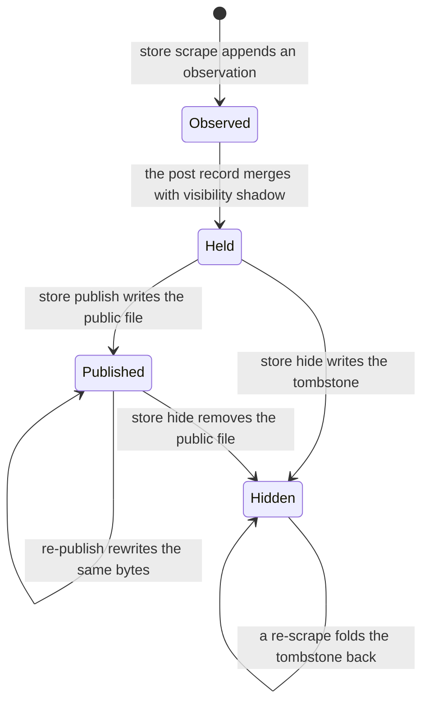
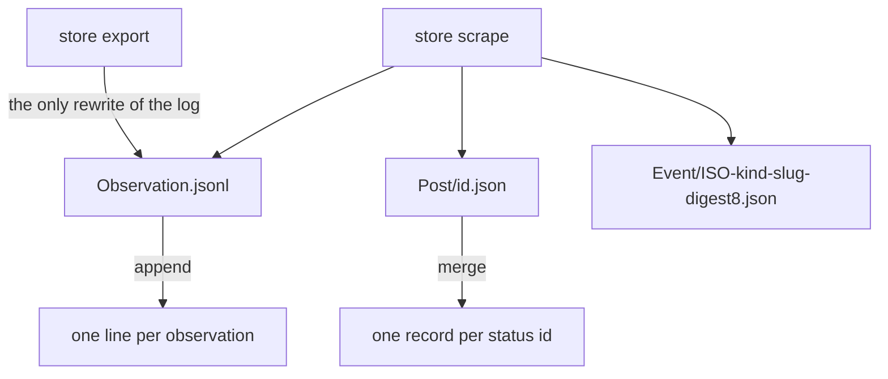
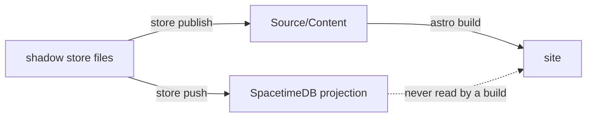
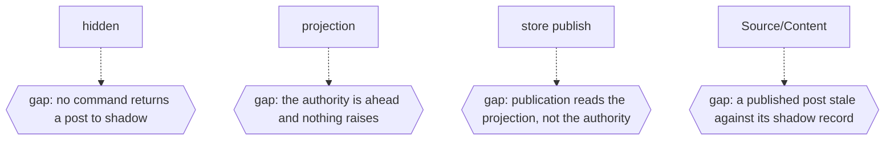

# Archive

## A post from scrape to publication

`store scrape` writes two things in one pass: a line in the observation log and a post record whose
`visibility` defaults to `shadow` (`Maintain/Source/Store/Merge/Merge.ts`). Publication is a
separate command, and withholding is a state rather than a deletion - `hidden` is a tombstone the
record keeps so that the archive still knows what it saw.

legend: solid arrow = a transition a file performs; dotted arrow = a transition nothing performs;
box = a state a file names; hexagon = a state no file names.

---

## The append-only rule beside it

Observations append; posts merge. `Observation.jsonl` is opened with `appendFileSync`, and the one
writer that rewrites the file is the export path that owns it whole
(`Maintain/Source/Store/Shadow/Shadow.ts`). An event is one file, named with eight hex characters of
its subject's digest, so two subjects that flatten to one slug stay two files
(`Documentation/Reference/Storage-Model.md`).

legend: solid arrow = a transition a file performs; dotted arrow = a transition nothing performs;
box = a state a file names; hexagon = a state no file names.

---

## Three layers, one direction

The files are the authority, the module is a projection that can be rebuilt, and the published
collection is the only layer the site reads (RFC-0001). `store push` builds the projection;
`store publish` writes the publication; no build reads the projection.

legend: solid arrow = a transition a file performs; dotted arrow = a transition nothing performs;
box = a state a file names; hexagon = a state no file names.

---

## The missing states

Four conditions the command surface has no state for. Each is described by a file and unreachable
from one, so it is drawn as a gap rather than as a transition nobody has written yet.

- No command returns a post to `shadow`. `store hide` is a tombstone, and
  `Maintain/Source/Command/Store/` holds no restore or unpublish command, so `public` and `hidden`
  are both one-way from the surface.
- The authority is ahead of the projection. RFC-0001 measured 209 posts and 344 observations in the
  files against 207 and 212 in the database, with no error raised anywhere.
- Publication is computed from the projection. `store publish` iterates `store.all()`, which reads
  the database, and records the visibility change through the `observe` reducer, while the same
  record calls the file store the authority; no file states which write the authority is.
- A published post is stale relative to its shadow record.
  `Documentation/Reference/Storage-Model.md` states that `store publish` and `store hide` are the
  only commands that write to `Source/Content/`, so a re-scrape that changes the record changes
  nothing the site serves.

legend: solid arrow = a transition a file performs; dotted arrow = a transition nothing performs;
box = a state a file names; hexagon = a state no file names.

