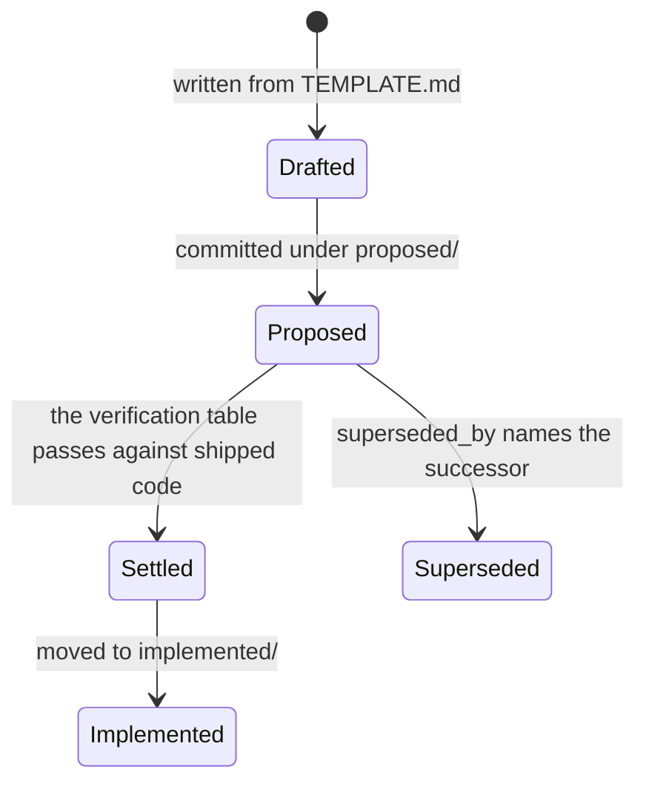
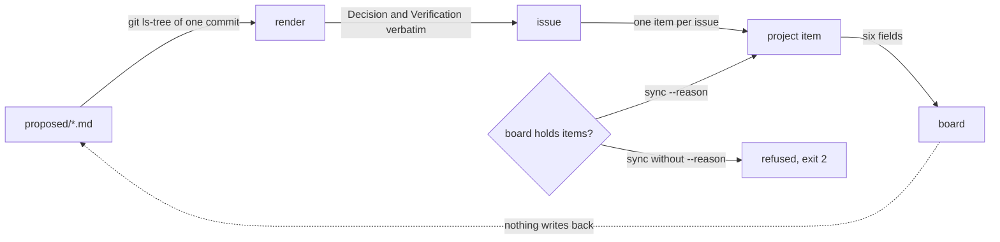
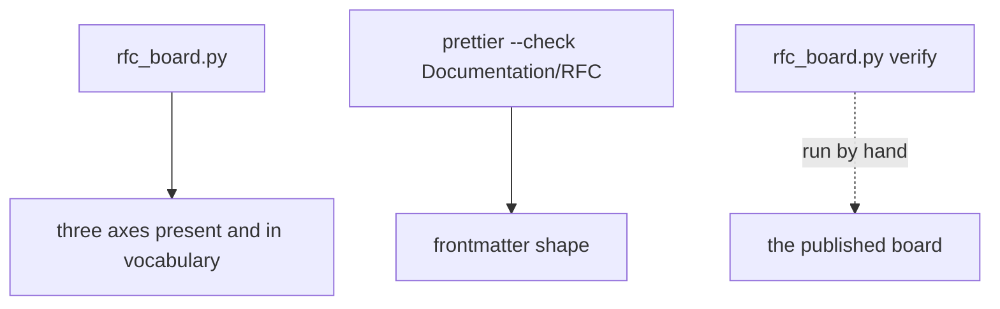
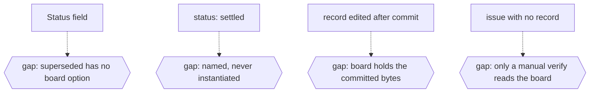

# Board

## An RFC record's life

A record is a file before it is anything else. It is written under `Documentation/RFC/proposed/`
from `TEMPLATE.md`, it carries `status: proposed` until its verification table passes against
shipped code, and it moves to `implemented/` only then (`Documentation/RFC/README.md`,
"Conventions"). Supersession is a field pair, not a deletion: the new record marks the old one
`superseded_by`, and both stay.

legend: solid arrow = a transition a file performs; dotted arrow = a transition nothing performs;
box = a state a file names; hexagon = a state no file names.

---

## The generation rule

The record is authoritative, the issue follows the record, the project item follows the issue, and
nothing in the procedure writes back into a record (`Documentation/Skill/RFC-Board/SKILL.md`). The
body is assembled rather than written - the `## Decision` section and the `## Verification` table
travel verbatim - so a body that differs from its record is detectable, and only `sync` rewrites it.
Only committed records publish: the list is `git ls-tree` of one commit.

legend: solid arrow = a transition a file performs; dotted arrow = a transition nothing performs;
box = a state a file names; hexagon = a state no file names.

---

## What holds the record's shape

`rfc_board.py` parses every record before it renders one: a missing axis, a value outside a
vocabulary, or a `category` that is not `<Kind>/<Subject>` is refused by name. The frontmatter is
written to the shape Prettier keeps, so `prettier --check Documentation/RFC` is clean without a
second pass. `verify` is the only thing that reads the published board, and it is run by hand.

legend: solid arrow = a transition a file performs; dotted arrow = a transition nothing performs;
box = a state a file names; hexagon = a state no file names.

---

## The missing states

Four conditions the corpus and the board can be in with nothing to name them. Each is stated by a
file and unreachable from any command that runs on its own, so it is drawn as a gap rather than as a
state the tool would report.

- `superseded` has no option on the board. The record renders its own word in the issue and leaves
  the field alone, so a superseded record and a proposed one are indistinguishable in `Status`.
- `settled` is named and never instantiated. All seventy-six records carry `status: proposed`, and
  `Documentation/RFC/implemented/` does not exist, so the settled and implemented states are
  vocabulary with no instance.
- A record edited after its commit publishes the committed bytes. The tree holds newer text, the
  board holds the old body, and the run reports it as a warning rather than as a state.
- An issue with no record, or a record with no issue, is called a defect of the same kind as an
  unlisted file, and only a manual `verify` reads the live board.

legend: solid arrow = a transition a file performs; dotted arrow = a transition nothing performs;
box = a state a file names; hexagon = a state no file names.

