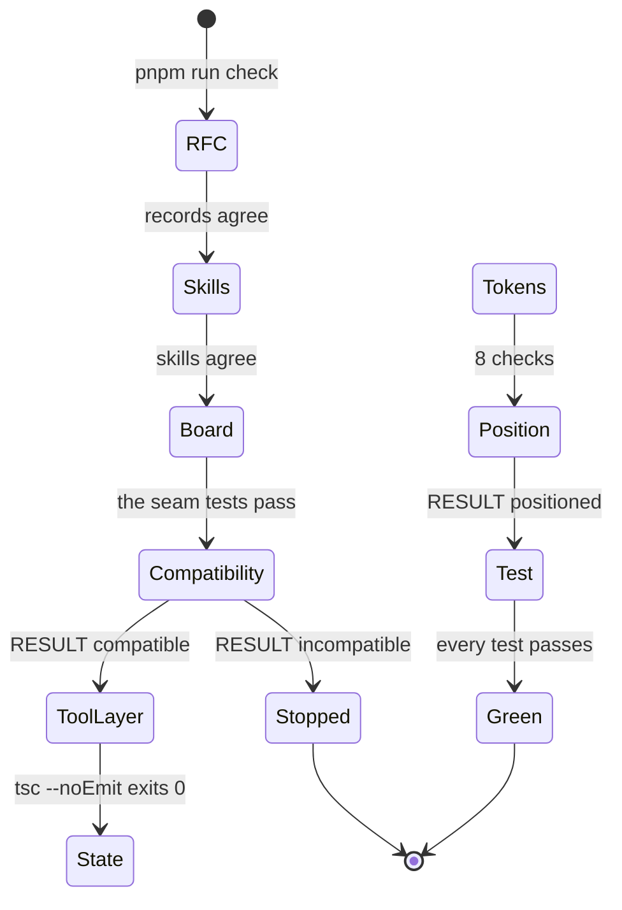
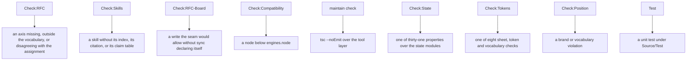
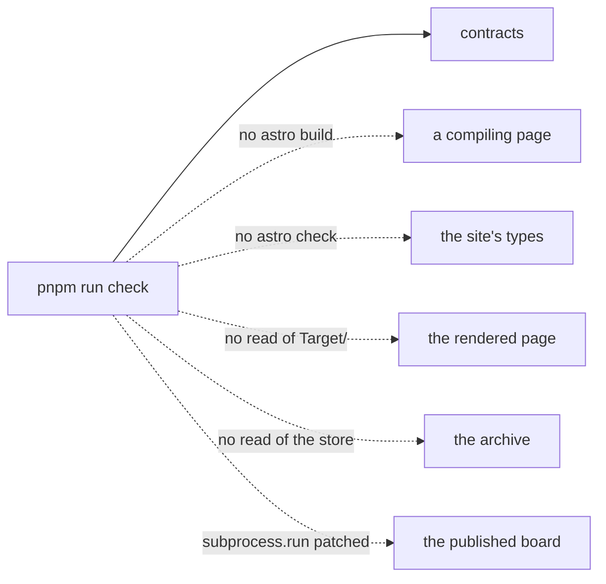
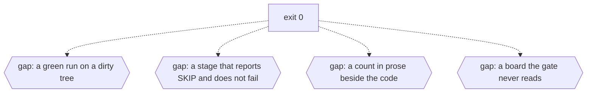

# Gates

## The chain

`pnpm run check` is nine steps in one line of `package.json`, and each step is independently
runnable, which is what makes a red gate locatable without reading the chain. The order is
deliberate: the interpreter floor comes before anything that a wrong interpreter would turn into a
syntax error that names neither the version nor the file (RFC-0074, rule 1).

legend: solid arrow = a transition a file performs; dotted arrow = a transition nothing performs;
box = a state a file names; hexagon = a state no file names.

---

## What fails each stage

Every stage states its own failure, and the chain stops at the first one. Only the floor check
distinguishes a wrong interpreter from a wrong tree; the later stages would each report a syntax
error instead (RFC-0074, rule 9).

legend: solid arrow = a transition a file performs; dotted arrow = a transition nothing performs;
box = a state a file names; hexagon = a state no file names.

---

## What the gate cannot see

The gate is a claim about contracts, not about the tree. It does not build, it does not type-check
the site, and it does not read the rendered page: no step of `pnpm run check` invokes `astro build`,
no `astro check` runs anywhere in the repository, and nothing in the chain reads `Target/`, HTML or
computed CSS (RFC-0074, rules 5 to 7). CI is narrower still - it runs the floor check and a build,
and the four contracts and the unit tests are local-only.

legend: solid arrow = a transition a file performs; dotted arrow = a transition nothing performs;
box = a state a file names; hexagon = a state no file names.

---

## The missing states

Four conditions a green run can hide. Each is stated by a file and unreadable by the gate, so it is
drawn as a gap rather than as a check the chain would report.

- A green run on a dirty tree. Nothing in the chain reads `git status`, and RFC-0074's own rule 8 -
  a green gate is a claim about contracts, not about the tree - is the one rule the record marks
  `open` because it names no file or command.
- A stage that reports and does not fail. The dependency half of the floor check prints `SKIP` when
  `pnpm outdated` is absent or the registry does not answer, and `INFO` when a major is available;
  none of the three changes the exit code (RFC-0074, rule 3).
- A count written twice. `package.json` lists nine steps while RFC-0074 calls the chain six, and the
  token contract prints eight checks while the archive index describes five; the code is the only
  durable count.
- The board the gate never reads. `Check:RFC-Board` patches `subprocess.run`, so a board that
  disagrees with the corpus still passes the gate; `verify` is run by hand.

legend: solid arrow = a transition a file performs; dotted arrow = a transition nothing performs;
box = a state a file names; hexagon = a state no file names.

