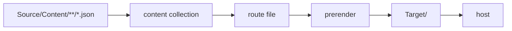
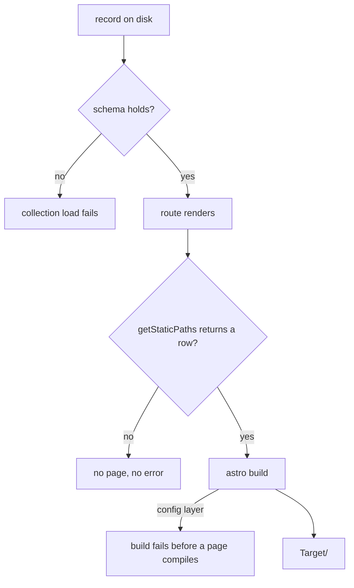
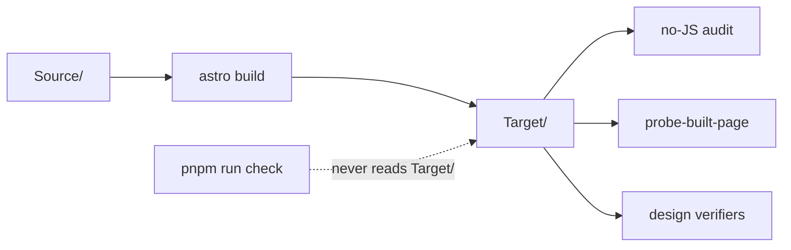
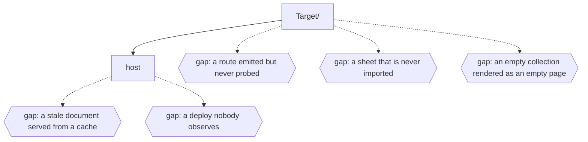

# Site

## The page lifecycle

A page is four steps, each reading what the previous one wrote. `Source/content.config.ts` globs
`Source/Content/**/*.json` into five collections; a route file under `Source/pages/` renders one
page per record through `getStaticPaths`; `astro build` prerenders the result into `Target/`
(`astro.config.ts` sets `srcDir`, `publicDir` and `outDir`); and the host serves that directory
after a push (`Documentation/Reference/Firebase.md` - the site is served by Cloudflare Pages and
deploys automatically on every push).

legend: solid arrow = a transition a file performs; dotted arrow = a transition nothing performs;
box = a state a file names; hexagon = a state no file names.

---

## What each stage can refuse

Three stages can refuse and one cannot. A record that fails its Zod schema stops the collection
load; a config-layer defect - PostCSS loading, a CSS alias, a package that resolves locally and not
in CI - stops the build before a page compiles. The route stage refuses nothing: a `getStaticPaths`
that returns an empty array emits no page and reports no error, so the route is simply absent from
the output.

legend: solid arrow = a transition a file performs; dotted arrow = a transition nothing performs;
box = a state a file names; hexagon = a state no file names.

---

## Two claims, not one

`astro build` proves the page compiles. It does not prove the page is the page. The audits that read
`Target/` - `Audit`, `Audit:Session` and `Audit:Store` in `package.json`, plus the design
verifiers - are run by hand, and `pnpm run check` never reads the output directory at all (RFC-0074,
rule 7).

legend: solid arrow = a transition a file performs; dotted arrow = a transition nothing performs;
box = a state a file names; hexagon = a state no file names.

---

## The missing states

Five conditions the tree has no edge for. Each has a file that describes it and no file that models
it, so it is drawn as a gap rather than as an intended transition.

- A stale document served from a browser cache. The build skill's probe cache-busts its URL because
  Chromium keeps the previous document across a rebuild.
- A route emitted but never probed. A green build cannot distinguish nine correct pages from nine
  with two silently absent; `find Target -name index.html` is the inventory, and nothing runs it on
  the build's behalf.
- A sheet that is never imported. The markup carries the class, the sheet holds the rule, the build
  is green, and the layout collapses.
- A deploy nobody observes. The host builds and serves on push, and no workflow or script in the
  tree reads the result of that deploy.
- An empty collection rendered as an empty page. An empty archive is a normal state, so a page
  rendering zero records is indistinguishable from a route that broke.

legend: solid arrow = a transition a file performs; dotted arrow = a transition nothing performs;
box = a state a file names; hexagon = a state no file names.

